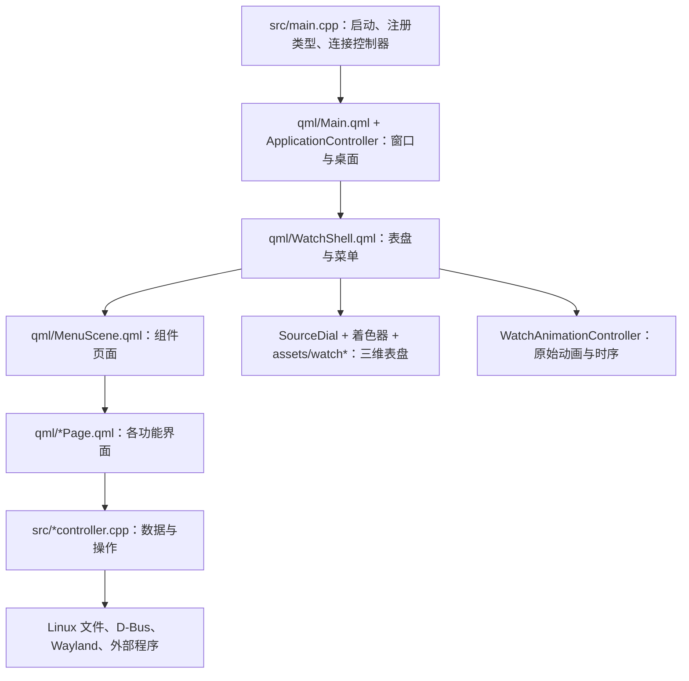

# HyprEndfield · Linux 移植版

基于 [EndfieldHUD](https://github.com/DDDuoDuo/EndfieldHUD) 的个人 Linux 移植项目，使用 C++20、Qt 6 / QML 和 LayerShellQt，在 Wayland 桌面上显示全屏 HUD。界面、动画和素材优先参考 EndfieldHUD；部分早期卡片几何参考了 `endfield_menu`，主表盘现已使用 EndfieldHUD 的分层三维资源。

**目前实际使用和验证的环境是 Arch Linux + Hyprland。其他发行版、桌面和播放器的修改位置见下文，尚未提供通用安装包或完成逐个平台的运行验证。** 本仓库的功能范围以本页 Linux 说明为准；末尾保留的上游说明介绍 macOS / Windows，包含本移植版没有实现的内容。

导航：[功能与限制](#linux-features) · [编译与启动](#linux-build) · [快捷键与毛玻璃](#linux-hyprland) · [组件地图](#component-map) · [发行版适配](#distribution-porting) · [桌面适配](#desktop-porting) · [替换软件](#software-porting) · [数据与隐私](#linux-data) · [上游说明](#upstream-readme)

<a id="linux-features"></a>
## 已经实现的内容

- **HUD 与表盘**：Wayland 全屏图层、分层三维表盘、视差与倾斜、展开与收起动画、旋转外圈和弯曲卡片。支持屏幕选择、缩放、位置、主题、时钟样式、模块排序与显隐；带标题的组件按当前菜单顺序连续编号 `MOD-01`、`MOD-02`……
- **便笺与视频便笺**：富文本、待办、图片、GIF、视频和绘图卡片；支持移动、调整大小和固定，内容保存到本地。
- **剪贴板**：直接接入 Wayland 的 `wlr-data-control`，收集文字、链接、图片和文件，再次复制；历史只保留在本次应用进程中，不读取 CopyQ。
- **文件暂存架**：添加文件和目录、拖入拖出、查看属性、打开文件和定位目录。保存原文件的引用，移除暂存条目不删除原文件。
- **档案库**：分类、富文本、图片与视频、文档锁定；设备所有者认证使用当前 Linux 用户的密码，通过 PAM 验证。
- **阅读器**：PDF、EPUB、TXT，本地书库与书签、横向或纵向阅读、字号设置、`Ctrl + 滚轮` 局部缩放与移动放大后的页面。
- **当前播放**：SPlayer 的曲目信息、封面、播放控制、进度和音量；另外接入 SPlayer WebSocket 歌词。
- **音量**：通过 PulseAudio 接口读取设备、默认输出、静音、音量、声道平衡和应用音量；PipeWire 环境需要提供 PulseAudio 兼容服务。
- **快捷终端**：原“快捷键”卡片改为嵌入式终端，保留键盘图标；当前启动 Bash。
- **专注模式与日历**：5 / 30 / 60 分钟及自定义倒计时、正计时、开始／暂停／继续／停止／重置与累计工作时间；隐藏 HUD 后继续计时。时钟下方在正常状态显示 `WORK MODE`，专注期间显示 `FOCUS MODE`。日历支持本地日程和提醒。
- **存储、活动监视器与设施警报**：磁盘选择及容量、CPU / RAM / GPU / 网络 / 磁盘信息、应用列表，以及内存、磁盘和温度告警。电池卡片读取系统电源信息。硬件或驱动没有提供的数据会显示不可用。
- **影像加工**：图片和视频裁剪、旋转、镜像、基本色彩调整、滤镜、曲线和色阶；图片贴纸及图片导出，视频通过 FFmpeg 导出 MP4。
- **投影与视频投影**：全屏绘画、点阵背景、插入图片或视频、移动和缩放媒体、播放视频。
- **账号与两套个人名片**：账号绑定、角色选择、终末地资料与理智信息、明日方舟理智信息；游戏名片采用 EndfieldHUD 素材，自定义名片独立保存资料。资料同步与头像同步有各自的选项。
- **融合！山团团！、事件日志、应用快捷方式**：小游戏使用移植的规则、Matter.js 物理和原素材；事件日志记录 HUD 内部事件；应用快捷方式使用 `.desktop` 文件，支持自定义名称与图标。
- **系统、显示和关于**：设置持久化、登录自启动、应用图标与中心标志、英语／简体中文／繁体中文／日语／韩语及部分动态状态文本、手动检查本仓库更新。低功耗视觉模式降低持续渲染频率、停止环境动画，并通过单独的图层名称避开 HUD 毛玻璃规则。

### 没有实现、停止继续扩展及使用边界

- **地图已移除**，包括地图前端。设置中保留的游戏主题图标属于图标资源，不代表存在地图模块。
- **自动下载安装更新没有实现**。关于页面可以手动检查仓库变化，更新仍需自行取得源码并编译；目前没有 DEB、RPM、AUR、Flatpak 等安装包或完整打包配置。
- **专注模式暂不扩展**：没有连接桌面“勿扰”、系统专注模式或自动化任务。累计工作时间会保存，正在进行的计时会话不会在退出应用或关机后自动续接；隐藏 HUD 不影响计时。
- **当前播放暂不扩展**：当前只自动识别 SPlayer，没有通用播放器选择界面，也没有其他歌词服务的自动回退。
- **文件暂存架暂不扩展**：当前保留 HUD 内的文件暂存流程，没有移植 macOS 菜单栏拖入和系统 Quick Look 体验。
- **界面动画暂不继续调整**：已经移植表盘、卡片和主要动画，仍有平台渲染差异；不承诺所有游戏粒子、辉光和材质效果逐像素一致。
- **“模糊程度”滑块暂不支持**，界面保留说明。实际毛玻璃由桌面合成器配置，应用没有单独调整自身模糊强度的通用接口。
- **影像加工仍有限制**：高光、阴影调整禁用；视频没有贴纸叠加；不支持 HDR 视频导出。图片编码和视频播放能力也取决于 Qt 图像插件、Qt Multimedia 与系统编解码器。
- **存储保留原版容量页面**：没有另行设计分类统计和大文件列表，也不执行分区、格式化或自动清理；“系统设置”入口按本移植版约定打开 Dolphin。
- **账号同步有范围限制**：实际使用过国服账号，国际服流程存在但未完成真实账号验证；明日方舟主要提供理智信息。头像同步需要单独开启，名片背景目前使用预设或自选图片，没有自动取得游戏账号背景。
- **投影场景不完整持久化**：全屏画布中的媒体摆放和绘图属于当前会话；视频便笺的内容由便笺模块保存。日历提醒也需要应用进程继续运行。
- **事件日志仅记录本应用事件**，不会展示整个 Linux 系统日志。活动监视器目前用于查看，没有进程终止功能。
- **平台限制仍然存在**：当前入口强制使用 Wayland，依赖 LayerShellQt 和指定 Wayland 协议；没有 X11 窗口实现。其他桌面不能仅凭“支持 Qt”判定可以完整运行。

<a id="linux-build"></a>
## 编译与启动

### 编译依赖

精确依赖以 [CMakeLists.txt](CMakeLists.txt) 为准：

- CMake 3.25+、支持 C++20 的编译器、C 编译器、Ninja、pkg-config。
- Qt 6.8+：Core、Gui、Widgets、Network、DBus、WebSockets、Qml、Quick、OpenGL、ShaderTools、Concurrent、Sql、Multimedia、Pdf、WebEngineWidgets。
- Qt 6 版 LayerShellQt。代码使用 `setCloseOnDismissed()`、`setWantsToBeOnActiveScreen()` 和屏幕选择接口；旧版本即使能被 CMake 找到，也可能缺少接口，需要升级或修改屏幕适配代码。
- `libpulse`、`vterm >= 0.3.3`、`wayland-client`、`libsecret-1`、`pam`、`libzip`、`gio-unix-2.0` 和 Linux `libutil`。
- `wayland-scanner` 以及 `wlr-data-control-unstable-v1.xml`。

在 Arch Linux 上，对应本项目使用的包名如下；这是安装命令示例，不会由应用自动执行：

```bash
sudo pacman -S --needed base-devel cmake ninja pkgconf \
  qt6-base qt6-declarative qt6-wayland qt6-shadertools \
  qt6-multimedia qt6-websockets qt6-webengine qt6-imageformats \
  layer-shell-qt libpulse libvterm wayland libsecret pam libzip glib2
```

运行时还需要 Qt Wayland 平台插件、QtQuick 的 Controls / Dialogs / Shapes / Effects / Layouts 等 QML 模块、`org.kde.layershell` QML 模块和 SQLite 驱动。QtWebEngine 的辅助进程与资源也必须安装完整，不能只复制主程序和几个动态库。参见 [Qt Linux 部署说明](https://doc.qt.io/qt-6/linux-deployment.html) 和 [Arch LayerShellQt 文件清单](https://archlinux.org/packages/extra/x86_64/layer-shell-qt/files/)。

按需安装的外部程序：

- `ffmpeg` / `ffprobe`：视频信息和导出；`ffmpegthumbnailer`：视频缩略图。
- `wl-clipboard`：部分文件粘贴入口调用 `wl-paste`；剪贴板历史模块自身直接使用 Wayland 协议。
- Dolphin：存储页面的文件管理器入口。SPlayer：当前播放和歌词。
- 提供 `org.freedesktop.secrets` 的已解锁密钥服务：账号凭据与档案库密码验证记录；仅安装 `libsecret` 客户端库还不够。
- 桌面会话 D-Bus、通知服务、PulseAudio 或 PipeWire-Pulse，以及所用桌面的全局快捷键配置。
- NVIDIA 的部分 GPU 指标会尝试使用 `nvidia-smi`，没有该程序或驱动能力时不保证显示这些指标。

### 从源码运行

在仓库根目录执行：

```bash
cmake -S . -B build -G Ninja -DCMAKE_BUILD_TYPE=Release -DBUILD_TESTING=OFF
cmake --build build --target hyprendfield -j2
./build/bin/HyprEndfield --background
./build/bin/HyprEndfield --toggle
```

二进制名称区分大小写：`HyprEndfield`；CMake 目标名称是 `hyprendfield`。`-j2` 可以自行按内存和处理器情况调整。

`--background` 在后台等待；`--show`、`--hide`、`--toggle` 控制 HUD；`--quit` 退出应用。无参数启动等同于切换 HUD。已有进程时，这些命令通过当前用户的本地通信接口通知原进程，不需要启动多份常驻应用。

也可以执行 `cmake --install build --prefix "$HOME/.local"`，将二进制安装到用户目录。当前安装规则只安装主程序；桌面启动器入口、合成器规则、系统依赖和密钥服务需要自行配置。

系统设置中的“登录时启动”会创建 `$XDG_CONFIG_HOME/autostart/hyprendfield.desktop`，记录当前二进制的绝对路径和 `--background`。桌面会话需要执行 XDG 自启动项；不执行这些启动项的窗口管理器需要自行配置启动命令。移动二进制后，重新关闭并开启该选项以更新路径。

所有正常编译需要的素材已经包含在 [assets/](assets/)，无需下载原项目再运行导入脚本。`test/`、`tests/` 和测试输出均被忽略，公开源码默认 `BUILD_TESTING=OFF`；本地测试文件不随 Git 提交。只有自己持有完整 `tests/` 时才启用测试，旧构建目录中的 CMake 缓存也需要留意。

<a id="linux-hyprland"></a>
## Hyprland：快捷键、输入与毛玻璃

本移植版约定 **Super + Esc 打开／关闭 HUD**。单独 Esc 留给终端和组件编辑操作，鼠标左键、右键不用于关闭整个 HUD。隐藏后应用继续运行；需要退出进程时使用 `--quit` 或托盘退出入口。

下面是本项目使用的 **Lua 配置接口**示例。将程序路径改为自己的绝对路径，合并到已有配置，勿重复定义同名快捷键或子键位配置：

```lua
local hyprEndfield = "/absolute/path/to/HyprEndfield"

hl.bind("SUPER + ESCAPE", hl.dsp.exec_cmd(hyprEndfield .. " --toggle"))

hl.define_submap("hyprendfield", function()
    hl.bind("SUPER + ESCAPE", function()
        hl.dispatch(hl.dsp.submap("reset"))
        hl.dispatch(hl.dsp.exec_cmd(hyprEndfield .. " --toggle"))
    end)
end)

hl.layer_rule({
    name = "hyprendfield-frosted-background",
    match = { namespace = "^hyprendfield$" },
    blur = true,
    ignore_alpha = 0.1,
})
```

应用展开期间会切换到 `hyprendfield` 子键位配置，收起时恢复 `reset`。其他希望在 HUD 展开期间继续使用的组合键，也需要加入该子键位配置。代码目前通过 `hyprctl eval` 调用 Lua；使用旧版 `hyprland.conf` 时，还需要修改 [applicationcontroller.cpp](src/applicationcontroller.cpp) 的子键位切换调用，改用对应版本支持的接口，不能只翻译上述配置文本。

图层名称分别为 `hyprendfield`（普通 HUD）、`hyprendfield-low-power`（低功耗）和 `hyprendfield-projection`（投影）。毛玻璃规则只匹配普通 HUD；泛化成匹配所有 `hyprendfield*` 会让低功耗或投影图层也受到影响。界面“模糊程度”滑块当前不修改这些规则。

<a id="component-map"></a>
## 组件地图：从功能找到代码

当前按技术类型存放文件：[qml/](qml/) 是界面，[src/](src/) 是 C++ 数据与系统操作，[assets/](assets/) 是素材，[shaders/](shaders/) 是着色器，[tools/](tools/) 是资源导入与维护工具。同一功能通常横跨这些目录；下面列出修改入口，C++ 的 `.hpp` 声明通常与同名 `.cpp` 放在一起。



### 程序入口、菜单与公共界面

- **启动、单实例、托盘、组件注册和控制器连接**：[src/main.cpp](src/main.cpp)。新增 C++ 文件、QML、资源或依赖时同时修改 [CMakeLists.txt](CMakeLists.txt)。
- **全屏图层、屏幕选择、显示隐藏、Hyprland 子键位配置**：[src/applicationcontroller.cpp](src/applicationcontroller.cpp)、[qml/Main.qml](qml/Main.qml)。
- **主表盘和菜单布局**：[qml/WatchShell.qml](qml/WatchShell.qml)、[qml/MenuScene.qml](qml/MenuScene.qml)。菜单透视和平面变换见 [MenuPlane.qml](qml/MenuPlane.qml)；卡片见 [MenuCard.qml](qml/MenuCard.qml)、[MenuTile.qml](qml/MenuTile.qml)、[SourceBottomButton.qml](qml/SourceBottomButton.qml)。
- **原版三维表盘、层次、材质与清晰度**：[src/sourcedial.cpp](src/sourcedial.cpp)、[shaders/](shaders/)、[assets/watch-dial/dial.json](assets/watch-dial/dial.json) 及同目录纹理；场景与相机在 [assets/watch/](assets/watch/)。修改表盘时优先检查这些内容。
- **卡片素材、外圈表面与几何**：[SourceSurface.qml](qml/SourceSurface.qml)、[MenuArt.qml](qml/MenuArt.qml)、[WatchSurfaces.js](qml/WatchSurfaces.js)、[MenuGeometry.js](qml/MenuGeometry.js)，对应 [assets/watch-surfaces/](assets/watch-surfaces/) 和 [assets/menu/](assets/menu/)。后者包含早期 HTML 参考资源，不代表主表盘仍使用那套平面背景。
- **展开、收起、旋转与视差**：[src/watchanimationcontroller.cpp](src/watchanimationcontroller.cpp)、[assets/watch/clips.json](assets/watch/clips.json)、[WatchShell.qml](qml/WatchShell.qml) 和 [MenuScene.qml](qml/MenuScene.qml)。
- **字体、颜色、滑块与通用图形**：[Appearance.js](qml/Appearance.js)、[HudSlider.qml](qml/HudSlider.qml)、[HudSettingsRow.qml](qml/HudSettingsRow.qml)、[HudGlyph.qml](qml/HudGlyph.qml)、[SourceGlyph.qml](qml/SourceGlyph.qml)、[ColorWheel.qml](qml/ColorWheel.qml)、[Redaction.qml](qml/Redaction.qml)、[RedactionBlock.qml](qml/RedactionBlock.qml)、[assets/fonts/](assets/fonts/)。字体加载在 `src/main.cpp`。
- **组件排序、显隐和 MOD 编号**：[SettingsController::defaultModules()](src/settingscontroller.cpp)、[WatchShell.qml](qml/WatchShell.qml) 的 `availableRightButtons`、[SystemPage.qml](qml/SystemPage.qml) 的模块名称与设置项，以及 [ModuleNumbering.js](qml/ModuleNumbering.js)。当前播放等没有 MOD 标题的页面不占编号；系统页面的 `SYS` 标识独立保留。

### 系统、显示、时钟与语言

- **系统设置**：[SystemPage.qml](qml/SystemPage.qml)；**显示设置**：[DisplayPage.qml](qml/DisplayPage.qml)、[DisplayExtras.qml](qml/DisplayExtras.qml)；**关于**：[AboutPage.qml](qml/AboutPage.qml)。共用 [SettingsHeader.qml](qml/SettingsHeader.qml)、[SettingsMenu.qml](qml/SettingsMenu.qml)，设置、校验、默认值和手动更新查询在 [src/settingscontroller.cpp](src/settingscontroller.cpp)。
- **右上角时钟**：[MenuClock.qml](qml/MenuClock.qml)、[ClockInstrument.qml](qml/ClockInstrument.qml)；`WORK MODE` / `FOCUS MODE` 的状态来自专注控制器与主界面连接。
- **中心标志与应用图标**：[src/centerlogo.cpp](src/centerlogo.cpp)、[assets/settings/](assets/settings/)；托盘与应用图标设置的应用过程在 `src/main.cpp`。
- **多语言**：[src/localization_catalog.inc](src/localization_catalog.inc) 是主要词条，[src/localization_status.inc](src/localization_status.inc) 补充 Linux 状态文本，翻译器在 `src/settingscontroller.cpp`。新增界面文本使用 `qsTr()`，C++ 文本使用现有翻译方式；词条检查工具为 [tools/check-translations.mjs](tools/check-translations.mjs)。
- **低功耗视觉模式**：设置在 `SystemPage.qml` 和 `settingscontroller.cpp`，持续动画与绘制在 `watchanimationcontroller.cpp`、`sourcedial.cpp`、`WatchShell.qml`；毛玻璃图层切换在 `applicationcontroller.cpp`。

### 日常工具

- **便笺、待办、视频便笺、绘图便笺**：界面入口 [NotesPage.qml](qml/NotesPage.qml)、[NotesWorkspace.qml](qml/NotesWorkspace.qml)，卡片 [NoteCard.qml](qml/NoteCard.qml)、[NotesTaskCard.qml](qml/NotesTaskCard.qml)，编辑条 [NotesFormatBar.qml](qml/NotesFormatBar.qml)、[NoteFormatMenu.qml](qml/NoteFormatMenu.qml)。保存、导入和编辑操作在 [src/notescontroller.cpp](src/notescontroller.cpp)，富文本辅助代码在 [src/richtext.hpp](src/richtext.hpp)；图片／视频共用 [MediaPreview.qml](qml/MediaPreview.qml)、[MediaSourceMenu.qml](qml/MediaSourceMenu.qml)。
- **剪贴板**：[ClipboardPage.qml](qml/ClipboardPage.qml)、[ClipboardCard.qml](qml/ClipboardCard.qml)、[ClipboardConfirmBar.qml](qml/ClipboardConfirmBar.qml)；监视、格式转换、再次复制和工作线程在 [src/clipboardcontroller.cpp](src/clipboardcontroller.cpp)。协议代码由 CMake 使用 XML 生成到构建目录。
- **文件暂存架**：[FileShelfPage.qml](qml/FileShelfPage.qml)、[ShelfTile.qml](qml/ShelfTile.qml)、[ShelfDocument.qml](qml/ShelfDocument.qml)、[ShelfProperties.qml](qml/ShelfProperties.qml)；文件引用、拖放与文件管理器调用在 [src/fileshelfcontroller.cpp](src/fileshelfcontroller.cpp)。
- **档案库与设备所有者认证**：[ArchivePage.qml](qml/ArchivePage.qml)、[ArchiveTile.qml](qml/ArchiveTile.qml)、[ArchiveCategoryPlate.qml](qml/ArchiveCategoryPlate.qml)、[ArchiveMediaStrip.qml](qml/ArchiveMediaStrip.qml)、[ArchiveLockedPanel.qml](qml/ArchiveLockedPanel.qml)；SQLite、锁定、密钥服务和 PAM 在 [src/archivecontroller.cpp](src/archivecontroller.cpp)。
- **阅读器**：[ReaderPage.qml](qml/ReaderPage.qml)、[ReaderTabs.qml](qml/ReaderTabs.qml)、[ReaderBookTile.qml](qml/ReaderBookTile.qml)、[ReaderPageSlider.qml](qml/ReaderPageSlider.qml)；PDF 渲染、EPUB / TXT 解析、书库和书签在 [src/readercontroller.cpp](src/readercontroller.cpp)。滚轮缩放、翻页与拖动的冲突处理需要同时查看 QML。
- **日历与提醒**：[CalendarPage.qml](qml/CalendarPage.qml)、[CalendarDayCell.qml](qml/CalendarDayCell.qml)、[CalendarEventPlate.qml](qml/CalendarEventPlate.qml)、[CalendarMonthPicker.qml](qml/CalendarMonthPicker.qml)、[CalendarFormat.js](qml/CalendarFormat.js)，以及同目录 `CalendarButton` / `CalendarTextField` / `CalendarConfirmBar`；日程保存与通知在 [src/calendarcontroller.cpp](src/calendarcontroller.cpp)。
- **专注计时**：[FocusModePage.qml](qml/FocusModePage.qml)、[FocusModeButton.qml](qml/FocusModeButton.qml)；后台计时、累计时间与状态在 [src/focusmodecontroller.cpp](src/focusmodecontroller.cpp)。
- **快捷终端**：[TerminalPage.qml](qml/TerminalPage.qml)、[src/terminalsession.cpp](src/terminalsession.cpp)（PTY 和 Shell 进程）、[src/terminalview.cpp](src/terminalview.cpp)（libvterm、绘制与键盘输入）。

### 音乐、图片与视频

- **当前播放**：[NowPlayingPage.qml](qml/NowPlayingPage.qml)、[NowPlayingButton.qml](qml/NowPlayingButton.qml)、[NowPlayingSection.qml](qml/NowPlayingSection.qml)；MPRIS 在 [src/nowplayingcontroller.cpp](src/nowplayingcontroller.cpp)，歌词在 [src/splayerlyrics.cpp](src/splayerlyrics.cpp)。换播放器主要修改这两个后端，详见[替换软件](#software-porting)。
- **音量**：[VolumePage.qml](qml/VolumePage.qml)、[VolumeRow.qml](qml/VolumeRow.qml)、[VolumeSlider.qml](qml/VolumeSlider.qml)、[VolumeDropdown.qml](qml/VolumeDropdown.qml)；PulseAudio 接口在 [src/audiocontroller.cpp](src/audiocontroller.cpp)。
- **影像加工**：[MediaAssemblyPage.qml](qml/MediaAssemblyPage.qml)，交互状态在 [src/mediaeditor.cpp](src/mediaeditor.cpp)，处理与导出在 [src/mediaengine.cpp](src/mediaengine.cpp)，媒体信息在 [src/mediainfo.cpp](src/mediainfo.cpp)。上游移植算法为 [media_assembly_model.cpp](src/endfield/modules/media_assembly_model.cpp)、[media_assembly_geometry.cpp](src/endfield/modules/media_assembly_geometry.cpp)、[media_assembly_processor.cpp](src/endfield/modules/media_assembly_processor.cpp)；滤镜 LUT、图标与贴纸在 [assets/media-assembly/](assets/media-assembly/)。
- **投影、点阵背景、全屏绘图与视频投影**：[ProjectionPage.qml](qml/ProjectionPage.qml) 是设置入口，[ProjectionWorkspace.qml](qml/ProjectionWorkspace.qml) 是全屏工作区，[ProjectionTools.qml](qml/ProjectionTools.qml) 是工具栏；绘图和点阵的 C++ 实现在 [src/projectioncanvas.cpp](src/projectioncanvas.cpp)，窗口模式切换在 `applicationcontroller.cpp`。点阵预览与实际画布都需要检查。
- **缩略图和图片提供器**：注册与部分实现集中在 [src/main.cpp](src/main.cpp)，不同页面的 `image://` 来源从这里查找；媒体格式探测共用 `src/mediainfo.cpp`。

### 系统信息与游戏相关组件

- **存储**：[StoragePage.qml](qml/StoragePage.qml)、[src/storagecontroller.cpp](src/storagecontroller.cpp)；Dolphin 入口是 `openDolphin()`。
- **活动监视器**：[ActivityPage.qml](qml/ActivityPage.qml)、[ActivityMetricRow.qml](qml/ActivityMetricRow.qml)、[ActivityFormat.js](qml/ActivityFormat.js)；数据调度在 [src/activitycontroller.cpp](src/activitycontroller.cpp)，Linux 采集与 Hyprland 窗口关联在 [src/activitycollector.cpp](src/activitycollector.cpp)。
- **设施警报与启动信息**：[FacilityBanner.qml](qml/FacilityBanner.qml)、[FacilityTags.qml](qml/FacilityTags.qml)、[HazardStripes.qml](qml/HazardStripes.qml)、[BootLog.qml](qml/BootLog.qml)；阈值与状态在 [src/facilitycontroller.cpp](src/facilitycontroller.cpp)，系统数据与活动监视器关联。
- **电池**：[BatteryBadge.qml](qml/BatteryBadge.qml)、[BatteryAlertWindow.qml](qml/BatteryAlertWindow.qml)、[src/batterycontroller.cpp](src/batterycontroller.cpp)。
- **个人名片**：[ProfilePage.qml](qml/ProfilePage.qml)、[ProfileField.qml](qml/ProfileField.qml)、[src/profilecontroller.cpp](src/profilecontroller.cpp)；自定义卡片 [MenuBadge.qml](qml/MenuBadge.qml)，游戏卡片 [GameProfileBadge.qml](qml/GameProfileBadge.qml)、[ProfileCardSource.js](qml/ProfileCardSource.js)，素材 [assets/profile-card/](assets/profile-card/)。自定义卡片中的 `ARCH` / `Hyprland` 标识目前仍在 QML 中定义，换发行版或桌面时需要修改。
- **账号绑定、资料同步与理智**：[AccountPage.qml](qml/AccountPage.qml)、[AccountGauge.qml](qml/AccountGauge.qml)、[src/accountcontroller.cpp](src/accountcontroller.cpp)、[src/accountlogin.cpp](src/accountlogin.cpp)、[src/accountartwork.cpp](src/accountartwork.cpp)。原版模型、接口、签名、登录、缓存、文本和理智计算集中在 [src/endfield/modules/](src/endfield/modules/) 下的 `hypergryph_account_*`；头像处理还使用 `profile_artwork.cpp`，资源在 [assets/account/](assets/account/)。
- **融合！山团团！**：[OrbiPomPage.qml](qml/OrbiPomPage.qml)、[src/orbipomcontroller.cpp](src/orbipomcontroller.cpp)、[assets/orbipom/orbipom.js](assets/orbipom/orbipom.js)、[assets/orbipom/](assets/orbipom/)。物理运行库为该目录中的 Matter.js。
- **事件日志**：[EventLogPage.qml](qml/EventLogPage.qml)、[src/eventlogcontroller.cpp](src/eventlogcontroller.cpp)、[src/eventlogtext.cpp](src/eventlogtext.cpp)；原版模型在 [event_log.cpp](src/endfield/modules/event_log.cpp)，存储在 [event_log_store.cpp](src/endfield/core/data/event_log_store.cpp)。事件来源的连接集中在 `src/main.cpp`。
- **添加应用／应用快捷方式**：[AppShortcutsPage.qml](qml/AppShortcutsPage.qml)、[src/appshortcutscontroller.cpp](src/appshortcutscontroller.cpp)、[assets/app-shortcut/](assets/app-shortcut/)。通过 GIO 解析和启动 `.desktop` 应用。
- **上游公共代码的 Linux 连接部分**：[src/endfield/data_platform.cpp](src/endfield/data_platform.cpp)、[src/endfield/core/data/](src/endfield/core/data/)、[src/endfield/core/localization.hpp](src/endfield/core/localization.hpp)、[src/endfield/core/scene.hpp](src/endfield/core/scene.hpp)。账号、日志、媒体模块会复用这些文件。

### 素材导入和新增组件

[tools/import-watch-dial.mjs](tools/import-watch-dial.mjs) 导入原版三维表盘；[import-watch-surfaces.mjs](tools/import-watch-surfaces.mjs) 导入表盘表面；[import-profile-card.mjs](tools/import-profile-card.mjs) 导入游戏名片；[import-settings-assets.mjs](tools/import-settings-assets.mjs) 导入设置素材和上游词条；[import-menu-art.mjs](tools/import-menu-art.mjs) 处理 `endfield_menu` 参考几何。

这些脚本需要 Node.js 和各自命令行指定的原仓库路径，部分还调用 `rsvg-convert` 或 ImageMagick `magick`。它们会重新生成资源或源码，日常编译无需执行。修改之前阅读脚本中的用法与输出路径；素材来源记录位于相应目录中的 `SOURCES.json`、`SOURCE.json` 或 `provenance.json`。

新增组件通常涉及以下位置：在 `qml/` 增加页面，在 `src/` 增加后端；在 `CMakeLists.txt` 登记文件与资源，在 `src/main.cpp` 连接控制器；在 `MenuScene.qml` 加入页面，在 `WatchShell.qml`、`SettingsController::defaultModules()` 和 `SystemPage.qml` 登记菜单与设置；有 MOD 标题时加入 `ModuleNumbering.js` 的对应列表，最后补充翻译。仅修改某个已有功能时，直接从上面的组件入口开始，无需移动整个目录。

<a id="distribution-porting"></a>
## 适配其他发行版

发行版主要影响依赖版本、开发包名称、Qt 插件位置和系统服务；桌面兼容性需要另外检查。下面提供修改方法，**不代表这些发行版已经实机验证**。

### Arch Linux 及其衍生发行版

参照上面的包名与构建命令。滚动更新后，Qt、QtWebEngine、LayerShellQt 与插件需要保持兼容；只复制本机生成的二进制到其他机器，不能保证依赖齐全。不同衍生发行版的软件仓库进度也可能不同。

### Debian / Ubuntu

把 CMake 依赖对应到该版本的软件包：例如 Qt 基础开发包 `qt6-base-dev`、LayerShellQt 开发包 `liblayershellqtinterface-dev`、终端库 `libvterm-dev`。另外补齐其余 Qt 开发组件、QML 运行模块、Wayland 平台插件、PDF、WebEngine、SQL SQLite 插件和各个 `lib*-dev` 依赖。

可先用 `apt-cache policy qt6-base-dev liblayershellqtinterface-dev libvterm-dev` 查看实际候选版本。本次整理时，Debian trixie 的 [Qt 基础开发包](https://packages.debian.org/trixie/qt6-base-dev) 为 6.8 系列，但 [LayerShellQt 开发包](https://packages.debian.org/trixie/liblayershellqtinterface-dev) 为 6.3 系列；不能仅检查 Qt 最低版本就认定满足全部 API 要求。旧版系统需要自行提供兼容的 Qt / LayerShellQt，或修改本项目所用的新接口。不要直接降低 CMake 版本约束来掩盖接口缺失。

### Fedora / RPM 系发行版

通常对应 `qt6-qtbase-devel` 等 Qt 开发包，以及 [layer-shell-qt-devel](https://packages.fedoraproject.org/pkgs/layer-shell-qt/layer-shell-qt-devel/)。可以用 `dnf repoquery --whatprovides 'cmake(Qt6Quick)' 'cmake(LayerShellQt)' 'pkgconfig(vterm)'` 查找提供相应构建接口的软件包，再按 CMake 的组件列表补齐依赖。

同属 RPM 系不代表版本相同；例如 EPEL 与 Fedora 的 Qt / LayerShellQt 可能属于不同代际。运行时还需检查编解码器、Qt 插件、Secret Service 和 PAM 的可用配置。

### openSUSE

使用 `zypper search -s qt6`、`zypper search -s layer-shell` 查询当前发行版提供的开发包，再按 CMake 组件和 pkg-config 名称安装。Tumbleweed 与 Leap 的版本需要分别确认，尤其是 Qt 6.8、libvterm 0.3.3 和 LayerShellQt 所需接口；本项目没有提供经验证的 openSUSE 构建配方。

### NixOS / 非标准安装目录

使用 Nix 的构建环境提供 Qt、LayerShellQt、pkg-config 和其他依赖，使用 Qt 包装工具设置运行时插件路径；相关机制见 [Nixpkgs 手册](https://nixos.org/manual/nixpkgs/unstable/) 的 Qt 与 `qt6.wrapQtAppsHook` 部分。仓库目前没有现成的 flake 或 derivation。

需要特别处理三处现有路径约定：

1. CMake 默认在 `/usr/share/qt6/wayland/protocols/wlr-data-control` 或 `/usr/share/wlr-protocols/unstable` 查找协议 XML。其他位置用 `-DWLR_DATA_CONTROL_PROTOCOL=/absolute/path/to/wlr-data-control-unstable-v1.xml` 指定。
2. 快捷终端在 `src/terminalsession.cpp` 中使用 `/usr/bin/bash`；需要替换为实际 Shell 路径，或实现读取用户登录 Shell 的逻辑。
3. FFmpeg、Dolphin、`wl-paste`、`hyprctl` 等通过程序名查找；将需要的程序加入运行环境 `PATH`。密钥服务、通知服务与音频服务仍由用户桌面会话提供。

对其他发行版也按上述依赖接口、路径和服务逐项处理。移植 CPU 架构时还需要验证 OpenGL ES 渲染、QtWebEngine、媒体编解码与三维素材加载，目前没有其他架构的完整验证结果。

<a id="desktop-porting"></a>
## 适配其他桌面或窗口管理器

有三类独立工作：**HUD 如何覆盖屏幕、如何接收全局快捷键、如何取得窗口与剪贴板数据**。应用目前直接使用 LayerShellQt 的 layer-shell 接口和 `wlr-data-control` 剪贴板协议；支持其中一项不能代替另外几项。LayerShellQt 的作用可参见 [KDE 项目说明](https://github.com/KDE/layer-shell-qt)。

- **其他 Hyprland 版本**：保留 Qt 页面，核对 `hyprctl eval`、Lua 配置和子键位切换。旧版接口的差异主要在 `applicationcontroller.cpp` 和合成器配置；窗口列表的解析在 `activitycollector.cpp`。
- **Sway / 其他 wlroots 桌面**：核对合成器是否提供 `zwlr_layer_shell_v1` 与 `zwlr_data_control_manager_v1`；将桌面快捷键绑定到程序的 `--toggle`，并处理输入焦点、屏幕选择和可选的按键模式。活动监视器需要把 Hyprland 窗口查询改为目标桌面的 IPC，例如 Sway 的窗口树；系统 CPU / 内存采集部分可以保留。
- **KDE Plasma Wayland**：检查所用 KWin 版本暴露的图层和数据控制协议，并分别适配。全局快捷键可由 KDE 快捷键设置调用 `--toggle`；窗口清单、输入焦点和毛玻璃规则需要 KWin 对应实现，不能直接沿用 `hyprctl`。未提供完整 KWin 适配。
- **GNOME Wayland**：需要为目标 Mutter / GNOME 版本确认可用的覆盖层与剪贴板能力；缺少当前协议时，需要实现桌面扩展或其他受支持的窗口与数据接口。仓库没有这些实现，单独增加启动快捷键不足以完成移植。
- **X11 桌面**：`src/main.cpp` 当前主动设置 `QT_QPA_PLATFORM=wayland`，QML 也依赖 LayerShell。需要增加普通 Qt 全屏置顶窗口的实现、相应焦点与全局快捷键处理，以及 X11 剪贴板监视。仅设置 `QT_QPA_PLATFORM=xcb` 不会启用一个现成的 X11 版本。

若准备统一全局快捷键，可以研究 [GlobalShortcuts Portal](https://flatpak.github.io/xdg-desktop-portal/docs/doc-org.freedesktop.portal.GlobalShortcuts.html)，但是否可用还取决于目标桌面的 portal 后端；本项目目前没有接入。模糊、窗口置顶、鼠标与键盘输入的桌面差异也仍需单独处理。

适配剪贴板时要区分 `wlr-data-control` 与其他 data-control 协议；当前实现直接绑定前者。目标桌面提供不同协议时，应在 `src/clipboardcontroller.cpp` 中增加对应实现，保持 QML 使用的数据和复制接口不变。普通应用剪贴板接口在某些 Wayland 桌面上只在聚焦时可用，不能据此宣称已经实现持续监视。

<a id="software-porting"></a>
## 替换播放器和其他软件

### 把 SPlayer 换成其他音乐播放器

播放控制和歌词分开实现：

1. **确认目标播放器提供 MPRIS。** 当前实现读取会话 D-Bus 中的 `/org/mpris/MediaPlayer2`，使用 `org.mpris.MediaPlayer2.Player` 和属性变化信号。标准服务名、元数据、能力字段与接口说明见 [MPRIS 规范](https://specifications.freedesktop.org/mpris/latest/)。
2. **修改播放器选择。** 在 [src/nowplayingcontroller.cpp](src/nowplayingcontroller.cpp) 中查找 `isSPlayer()`、`discover()` 和服务所有者变化处理。当前只匹配 `org.mpris.MediaPlayer2.splayer` 及其带实例后缀的名称；改为目标服务名，或自行增加明确的选择设置。不要把所有播放器混成同一个控制目标。
3. **保留对界面的数据接口。** 检查封面、标题、歌手、`mpris:trackid`、`mpris:length`、`Position`、`Volume` 和控制能力。MPRIS 进度以微秒计，现有后端负责换算；播放器未提供进度、音量或跳转能力时，界面需要保持不可用状态。
4. **单独替换歌词。** [src/splayerlyrics.cpp](src/splayerlyrics.cpp) 使用 SPlayer 专有的 WebSocket 消息，其他 MPRIS 播放器未必提供这个接口。换成目标软件的歌词来源，或停用歌词连接并保留无歌词状态；相关对象在 [src/main.cpp](src/main.cpp) 中创建并暴露给 QML。
5. **调整名称和检查切歌行为。** [NowPlayingPage.qml](qml/NowPlayingPage.qml) 与 [localization_status.inc](src/localization_status.inc) 中有 SPlayer 名称；检查暂停、继续、切歌、拖动进度、播放器退出和旧歌词清除。此处是适配步骤，仓库没有内置通用播放器切换选项。

当前 SPlayer 歌词连接读取 `$XDG_CONFIG_HOME/SPlayer/config.json` 中的 `websocket` 配置，并连接本机 `ws://127.0.0.1:<port>`，默认端口为 `25885`。使用时需要在 SPlayer 内启用 WebSocket；HyprEndfield 不替你开启服务。客户端连接本机不代表 SPlayer 服务只监听本机，服务的监听范围由 SPlayer 决定。连接请求 `get-song-info` 并处理歌曲与歌词变化，按歌曲标识检查当前歌词，不能把这套消息格式直接套用到别的播放器。

### 文件管理器、终端、音频和其他入口

- **Dolphin → 其他文件管理器**：修改 [StorageController::openDolphin()](src/storagecontroller.cpp) 的程序与参数，也调整对应按钮文案。文件暂存架的“在文件管理器中显示”还使用 [FileManager1 的调用代码](src/fileshelfcontroller.cpp)，需要同时检查；文件默认打开通常交给 `QDesktopServices`。
- **Bash → Zsh / Fish / 用户默认 Shell**：修改 [TerminalSession::startDefault()](src/terminalsession.cpp)。当前固定 `/usr/bin/bash -i`；可以自行实现读取系统用户资料中的登录 Shell，并按目标 Shell 确定启动参数。终端显示和输入仍由 `terminalview.cpp` / libvterm 处理。
- **PulseAudio → PipeWire**：提供 PipeWire-Pulse 后可以继续使用 [audiocontroller.cpp](src/audiocontroller.cpp) 的 libpulse 接口，无需把界面改写成另一套。仅有 ALSA 的环境需要另写音量与设备后端，当前没有该实现。
- **通知程序**：日历等使用 `org.freedesktop.Notifications`，没有硬编码 Dunst。替换为提供同一 D-Bus 服务的通知程序；桌面关闭通知或应用退出时不保证提醒可见。
- **应用快捷方式**：通过 [appshortcutscontroller.cpp](src/appshortcutscontroller.cpp) 的 GIO 和 `.desktop` 启动。应用的执行参数优先写入合法的 `.desktop` 文件；不要把用户输入拼成 Shell 命令。包管理方式改变时也要确认 `.desktop` 文件是否位于桌面可发现的目录。
- **账号与密钥服务**：账号凭据通过 libsecret 使用 Secret Service；更换桌面时确保对应服务实际提供该接口并已解锁。没有密钥服务时不会自动改为明文保存账号凭据。
- **Linux 用户密码认证**：[archivecontroller.cpp](src/archivecontroller.cpp) 当前使用 PAM 的 `login` 服务。其他发行版的 PAM 栈和权限可能不同，需要在目标系统验证；如需专用 PAM 服务，应由发行版适配者编写配置，保留系统认证策略，不通过硬编码密码或直接读取密码哈希来替代。
- **发行版名称与桌面标识**：[MenuBadge.qml](qml/MenuBadge.qml) 当前使用 `ARCH` 和 `Hyprland`。可以修改显示文字；若要自动识别，需要另行接入 `/etc/os-release` 或 `QSysInfo`、桌面会话信息，再把结果传给 QML。当前没有自动识别功能。
- **传感器与 GPU**：[activitycollector.cpp](src/activitycollector.cpp)、[batterycontroller.cpp](src/batterycontroller.cpp) 分别使用 `/proc`、`/sys/class/hwmon`、`/sys/class/power_supply` 和可用的驱动接口。更换硬件时按实际设备能力调整，缺少数据应保留未知状态，不填入固定数值。
- **视频处理与播放**：探测和导出查看 `mediainfo.cpp` / `mediaengine.cpp`，播放查看 `MediaPreview.qml` 与投影工作区。外部程序调用按参数列表传递，替换工具时保留路径处理、失败提示和导出完成确认。

<a id="linux-data"></a>
## 本地数据、隐私与 Git 忽略范围

以下位置按 Qt 标准路径生成。`$XDG_CONFIG_HOME` 未设置时使用 `$HOME/.config`，`$XDG_DATA_HOME` 未设置时使用 `$HOME/.local/share`。应用不会把正常用户数据写到源码仓库。

- **设置**：`$XDG_CONFIG_HOME/HyprEndfield/HyprEndfield.conf`，包括显示、模块设置和累计工作时间等。
- **登录启动项**：开启相应设置后写入 `$XDG_CONFIG_HOME/autostart/hyprendfield.desktop`，包含本机程序路径。
- **便笺**：`$XDG_DATA_HOME/HyprEndfield/Notes/`，包含 `notes.json`、图片和导入媒体。
- **日历、暂存架、档案库、阅读器**：分别为 `$XDG_DATA_HOME/HyprEndfield/Calendar/calendar.json`、`FileShelf/shelf.json`、`Archive/archive.sqlite`、`Reader/library.json`，后三个路径与日历共用 `HyprEndfield/` 前缀。
- **两套名片**：`$XDG_DATA_HOME/HyprEndfield/Profile/` 与 `GameProfile/`，各自保存 `profile.json` 和自选图片。
- **账号缓存、应用快捷方式、事件日志、自定义中心标志**：使用 Qt 的 AppData 路径，当前组织名与应用名都为 `HyprEndfield`，因此位于 `$XDG_DATA_HOME/HyprEndfield/HyprEndfield/` 下的 `Account/`、`AppShortcuts/`、`EventLog/`、`CenterLogo/`。重复的目录名称来自当前代码，备份或迁移时需要留意。
- **账号凭据和档案库密码验证记录**：保存在桌面的 Secret Service 中，单独复制上述 JSON / SQLite 文件不会迁移这些记录。Linux 用户密码只用于 PAM 验证，不作为应用数据保存。
- **剪贴板历史**：保存在内存，退出应用后清空。隐藏 HUD 不会退出进程，因而不会清空历史。

档案库的锁定属于应用内访问控制，SQLite 数据库和媒体文件没有提供整个文件的加密保护。账号资料、头像、便笺、文件引用、日历和事件日志都可能包含私人信息；事件日志也可能出现文件名。分享错误报告时只提供必要的已遮盖内容，不应上传整个数据目录。

[.gitignore](.gitignore) 已忽略 `test/`、`tests/`、构建目录、缓存、测试输出、临时截图、常见凭据文件，以及误放到仓库中的应用私有数据目录和文件。原作者署名、许可证、素材来源记录与资源哈希继续保留。

**忽略规则只控制未跟踪文件；已经提交的内容不会因新增规则而从历史消失。** 本次测试目录已取消 Git 跟踪，本地保留；旧提交仍含历史测试文件。当前清理没有重写 Git 历史，也没有删除本机账号、便笺或其他用户数据。如果以后误提交真实凭据，需要立即在服务端撤销凭据，并另行处理历史。

## 来源与许可

主参考项目为 [DDDuoDuo/EndfieldHUD](https://github.com/DDDuoDuo/EndfieldHUD)，本移植所用参考版本为 `e9a6bdc2fe468008c830132715998161f002b902`。原代码与授权信息见 [LICENSE](LICENSE)、[src/endfield/LICENSE](src/endfield/LICENSE) 和 [assets/settings/EndfieldHUD-LICENSE](assets/settings/EndfieldHUD-LICENSE)；Matter.js 与字体分别保留 [Matter 许可证](assets/orbipom/Matter-LICENSE.txt)、[HarmonyOS Sans 许可证](assets/fonts/HarmonyOS-Sans-LICENSE.txt)。

这是非官方同人移植。游戏素材、商标和第三方资源保留各自权利与许可，代码许可证不自动授予游戏素材的再分发权。上游完整鸣谢见 [EndfieldHUD CREDITS](https://github.com/DDDuoDuo/EndfieldHUD/blob/e9a6bdc2fe468008c830132715998161f002b902/CREDITS.md)。

<a id="upstream-readme"></a>
## 上游 EndfieldHUD 中文说明

下面保留上述参考版本的中文 README，仅将相对链接改为指向该版本的上游文件。这里的下载、系统要求、快捷键、权限、数据位置和更新方式适用于上游 macOS / Windows，**Linux 用户请使用本页前面的说明**。其中的地图不属于 HyprEndfield；上游反馈入口也不用于报告本移植版特有问题。

<details>
<summary>展开上游原版说明（macOS / Windows）</summary>

<a href="https://github.com/DDDuoDuo/EndfieldHUD/releases/tag/v1.3.0"></a>

<p align="center">
  <a href="https://github.com/DDDuoDuo/EndfieldHUD/releases/tag/v1.3.0"></a>
  <a href="https://github.com/DDDuoDuo/EndfieldHUD/blob/e9a6bdc2fe468008c830132715998161f002b902/LICENSE"></a>
  <a href="#installation"></a>
  <a href="https://wj.qq.com/s2/28548057/ejeu/"></a>
  <a href="https://space.bilibili.com/223936961"></a>
</p>

<p align="center">
  <a href="https://github.com/DDDuoDuo/EndfieldHUD/blob/e9a6bdc2fe468008c830132715998161f002b902/README.md"></a>
  <a href="https://github.com/DDDuoDuo/EndfieldHUD/blob/e9a6bdc2fe468008c830132715998161f002b902/README.zh-CN.md"></a>
  <a href="https://github.com/DDDuoDuo/EndfieldHUD/blob/e9a6bdc2fe468008c830132715998161f002b902/README.zh-TW.md"></a>
  <a href="https://github.com/DDDuoDuo/EndfieldHUD/blob/e9a6bdc2fe468008c830132715998161f002b902/README.ja.md"></a>
  <a href="https://github.com/DDDuoDuo/EndfieldHUD/blob/e9a6bdc2fe468008c830132715998161f002b902/README.ko.md"></a>
</p>

<p align="center">
  一款能让你成为真正的管理员的软件<br>
  只需要按快捷键或点击菜单栏，就可以打开终末地的终端——你可以记便笺、放文件、听音乐、看游戏数据，以及使用各种日常小工具
</p>

<br>

<a name="installation"></a>


<a href="https://github.com/DDDuoDuo/EndfieldHUD/releases/tag/v1.3.0"></a>

<sub>※ EndfieldHUD 会出现在菜单栏里。按一下快捷键，HUD 就会出现在所有软件的上方</sub>

<table>
<tr>
<td width="120"></td>
<td><a href="https://github.com/DDDuoDuo/EndfieldHUD/releases/download/v1.3.0/EndfieldHUD-1.3.0-build19-Installer.pkg"><b>PKG 安装包</b></a> / <a href="https://github.com/DDDuoDuo/EndfieldHUD/releases/download/v1.3.0/EndfieldHUD-1.3.0-build19-macOS.dmg"><b>DMG</b></a> / <a href="https://github.com/DDDuoDuo/EndfieldHUD/releases">所有版本</a></td>
</tr>
<tr>
<td></td>
<td>已经装过 EndfieldHUD 了？在菜单栏点击<b>检查更新</b></td>
</tr>
<tr>
<td></td>
<td>1. 打开 DMG，把 <b>EndfieldHUD.app</b> 拖进 <b>Applications（应用程序）</b>，也可以运行 PKG 安装包。<br>2. 从“应用程序”打开 EndfieldHUD，菜单栏里会出现它的图标</td>
</tr>
<tr>
<td></td>
<td>按 <kbd>Ctrl</kbd> + <kbd>`</kbd> 打开 HUD（<a href="https://github.com/DDDuoDuo/EndfieldHUD/blob/e9a6bdc2fe468008c830132715998161f002b902/docs/system-overlay.md">原理说明</a>）。快捷键可以到<b>设置</b>里修改</td>
</tr>
</table>

> [!WARNING]
> 如果 macOS 拦住了应用，到**系统设置 → 隐私与安全性 → 仍要打开**，再确认一次。这是因为应用目前还没有经过 Apple 公证

<br>


<a href="https://github.com/DDDuoDuo/EndfieldHUD/releases/tag/v1.3.0"></a>

<sub>※ 在 Windows 上，EndfieldHUD 待在通知区域（系统托盘）里。同样的 HUD，同样的快捷键</sub>

<table>
<tr>
<td width="120"></td>
<td><a href="https://github.com/DDDuoDuo/EndfieldHUD/releases/download/v1.3.0/EndfieldHUD-1.3.0-build19-windows-x64-setup.exe"><b>安装程序（EXE）</b></a> / <a href="https://github.com/DDDuoDuo/EndfieldHUD/releases/download/v1.3.0/EndfieldHUD-1.3.0-build19-windows-x64-portable.zip"><b>便携版（ZIP）</b></a> / <a href="https://github.com/DDDuoDuo/EndfieldHUD/releases">所有版本</a></td>
</tr>
<tr>
<td></td>
<td>已经装过 EndfieldHUD 了？在<b>关于</b>里点击<b>检查更新</b>，或者直接运行新版安装程序覆盖安装，数据会保留</td>
</tr>
<tr>
<td></td>
<td>1. 运行安装程序（不需要管理员权限），跟着屏幕上的提示安装。安装完后会在“开始”菜单里加上 EndfieldHUD。<br>2. 想开机时自动启动就勾选<b>登录时启动</b>。然后点<b>安装</b>，再点<b>打开 EndfieldHUD</b></td>
</tr>
<tr>
<td></td>
<td>图标会在通知区域（系统托盘），不在菜单栏。和 Mac 一样，按 <kbd>Ctrl</kbd> + <kbd>`</kbd> 打开 HUD，快捷键可以到<b>快捷键</b>里修改</td>
</tr>
<tr>
<td></td>
<td>不想安装？下载ZIP版，解压到任意位置，运行 <b>EndfieldHUD.exe</b> 即可。不过软件并不会加到“开始”菜单，你也收不到日历提醒通知</td>
</tr>
<tr>
<td></td>
<td>要卸载的话，到<b>设置 → 应用 → 已安装的应用 → EndfieldHUD → 卸载</b>。除非勾选<b>同时删除我的 EndfieldHUD 数据</b>，否则数据都会保留</td>
</tr>
</table>

> [!WARNING]
> 如果 Windows SmartScreen 弹出**Windows 已保护你的电脑**，点**更多信息 → 仍要运行**。这是因为应用目前还没有进行签名

<br>


<table>
<tr>
<td width="120"></td>
<td>用两侧按钮切换功能，右侧可滚动。<b>Esc</b> 会先退出编辑，再关闭 HUD。关闭 HUD 后应用仍会运行；点击红色电源按钮或右键菜单栏处的图标可以退出应用</td>
</tr>
</table>

<br>


<table>
<tr>
<td width="120"></td>
<td>苹果 M 系列芯片：<b>macOS 11+</b>。Intel：<b>macOS 10.15.4+</b>。部分功能需要更新的系统或支持的硬件</td>
</tr>
<tr>
<td></td>
<td><b>Windows 11 64 位（x64）</b>，不支持 Windows 10 和 ARM64。需要支持 Direct3D 11 的显卡，以及大约 64 MiB 磁盘空间</td>
</tr>
</table>


用到相关功能时，再允许它需要的权限：

| 权限 | 用来做什么 |
| --- | --- |
| **辅助功能** | 让工作模式通过控制中心切换 macOS 专注模式。不授权也能用计时器 |
| **系统音频录制** | macOS 14.2+ 的实验性独立应用音量控制。不会保存音频 |
| **自动化** | 在 macOS 提示时，允许控制支持的音乐应用 |
| **通知** | 更新提醒和日历提醒 |
| **文件与文件夹** | 打开你选择的文件、图片和视频 |

> [!TIP]
> 权限可以在**系统设置 → 隐私与安全性**里查看；通知有单独的设置页面

<br>


| 工具 | 可以做什么 |
| --- | --- |
| [**便笺**](https://github.com/DDDuoDuo/EndfieldHUD/blob/e9a6bdc2fe468008c830132715998161f002b902/docs/notes-canvas.md) | 写字、画画、待办列表，还能添加图片或视频。把面板固定后切换到别的模块不会消失 |
| [**文件暂存架**](https://github.com/DDDuoDuo/EndfieldHUD/blob/e9a6bdc2fe468008c830132715998161f002b902/docs/file-shelf.md) | 拖入、预览文件，还能再拖出来。原文件保留在原本的位置 |
| [**剪贴板**](https://github.com/DDDuoDuo/EndfieldHUD/blob/e9a6bdc2fe468008c830132715998161f002b902/docs/clipboard-cache.md) | 滚动查看最近复制的文字、链接、图片和文件。退出应用后清空历史 |
| [**档案库**](https://github.com/DDDuoDuo/EndfieldHUD/blob/e9a6bdc2fe468008c830132715998161f002b902/docs/archive.md) | 按自己的分类保存文档，支持富文本和图片、视频 |
| [**应用快捷方式**](https://github.com/DDDuoDuo/EndfieldHUD/blob/e9a6bdc2fe468008c830132715998161f002b902/docs/app-shortcuts.md) | 添加自己的应用，自定义名称和图标 |


| 工具 | 可以做什么 |
| --- | --- |
| [**阅读器**](https://github.com/DDDuoDuo/EndfieldHUD/blob/e9a6bdc2fe468008c830132715998161f002b902/docs/reader.md) | 看小说和 PDF，加书签，放大页面 |
| [**影像加工**](https://github.com/DDDuoDuo/EndfieldHUD/blob/e9a6bdc2fe468008c830132715998161f002b902/docs/media-assembly.md) | 裁剪、调整图片和视频，添加滤镜和贴纸 |
| [**投影**](https://github.com/DDDuoDuo/EndfieldHUD/blob/e9a6bdc2fe468008c830132715998161f002b902/docs/projection.md) | 在全屏画布上画画，也可以打开点阵背景 |
| [**当前播放**](https://github.com/DDDuoDuo/EndfieldHUD/blob/e9a6bdc2fe468008c830132715998161f002b902/docs/now-playing.md) | 看专辑封面和可用的歌词，控制播放 |


| 工具 | 可以做什么 |
| --- | --- |
| [**工作模式与音量**](https://github.com/DDDuoDuo/EndfieldHUD/blob/e9a6bdc2fe468008c830132715998161f002b902/docs/audio-and-work-mode.md) | 进入专注模式，切换音频设备，[调整设备支持的音量选项](https://github.com/DDDuoDuo/EndfieldHUD/blob/e9a6bdc2fe468008c830132715998161f002b902/docs/per-app-audio.md) |
| [**日历**](https://github.com/DDDuoDuo/EndfieldHUD/blob/e9a6bdc2fe468008c830132715998161f002b902/docs/calendar.md) | 用倒计时或秒表，记录日程并设置提醒 |
| [**电源、存储与活动监视器**](https://github.com/DDDuoDuo/EndfieldHUD/blob/e9a6bdc2fe468008c830132715998161f002b902/docs/storage-and-activity.md) | 查看充电状态、磁盘空间、CPU、RAM 和运行中的应用 |


| 工具 | 可以做什么 |
| --- | --- |
| [**地图**](https://github.com/DDDuoDuo/EndfieldHUD/blob/e9a6bdc2fe468008c830132715998161f002b902/docs/map.md) | 探索离线地形图，添加并自定义标记 |
| [**可露希尔的小游戏**](https://github.com/DDDuoDuo/EndfieldHUD/blob/e9a6bdc2fe468008c830132715998161f002b902/docs/orbipom-runtime.md) | 玩融合！山团团！ |
| [**事件日志**](https://github.com/DDDuoDuo/EndfieldHUD/blob/e9a6bdc2fe468008c830132715998161f002b902/docs/event-log.md) | 像真正的管理员一样查看事件日志 |
| [**个人名片**](https://github.com/DDDuoDuo/EndfieldHUD/blob/e9a6bdc2fe468008c830132715998161f002b902/docs/personal-profile.md) | 自定义名片，自由编辑个人资料 |
| [**账号绑定**](https://github.com/DDDuoDuo/EndfieldHUD/blob/e9a6bdc2fe468008c830132715998161f002b902/docs/account-linking.md) | 绑定鹰角游戏账号，同步资料和理智倒计时 |

<sub>※ 账号绑定可选</sub>


<table>
<tr>
<td width="120"></td>
<td>在<a href="https://github.com/DDDuoDuo/EndfieldHUD/blob/e9a6bdc2fe468008c830132715998161f002b902/docs/settings.md"><b>设置</b></a>里可以改主题、倾斜、时钟、图标和动画设置</td>
</tr>
<tr>
<td></td>
<td>HUD 支持英语、简体中文、繁体中文、日语和韩语</td>
</tr>
<tr>
<td></td>
<td>便笺和设置都留在你的 Mac 上。绑定后的社区凭据保存在 macOS 钥匙串里。更新来自 GitHub；菜单栏和<b>关于</b>里都有更新选项</td>
</tr>
</table>

<br>


<table>
<tr>
<td width="120"></td>
<td><a href="https://github.com/DDDuoDuo">DDDuoDuo</a></td>
</tr>
<tr>
<td></td>
<td>《明日方舟：终末地》、<a href="https://github.com/QinAnze/zmd-charge">QinAnze</a> 和 <a href="https://www.bilibili.com/video/BV1DBaP6yEHs/">llynxxx</a></td>
</tr>
<tr>
<td></td>
<td>原创代码采用 <a href="https://github.com/DDDuoDuo/EndfieldHUD/blob/e9a6bdc2fe468008c830132715998161f002b902/LICENSE">MIT 许可证</a>，第三方素材和库保留各自的许可条款。<a href="https://github.com/DDDuoDuo/EndfieldHUD/blob/e9a6bdc2fe468008c830132715998161f002b902/CREDITS.md">完整鸣谢</a></td>
</tr>
</table>

<sub>※ 这是一个非官方同人项目。游戏素材和品牌标识归鹰角网络及各自的权利人所有</sub>

<br>


<a href="https://github.com/DDDuoDuo/EndfieldHUD/issues"></a>

</details>
